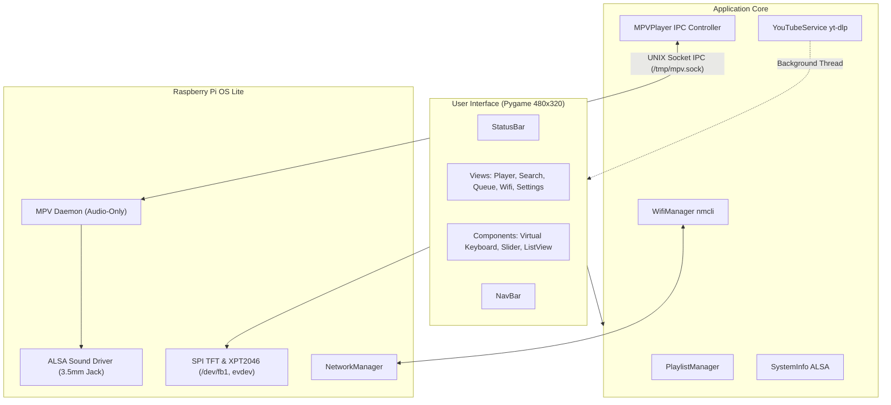

# Pi Music 🎵
> **Lightweight, High-Performance YouTube Music Player for Raspberry Pi 3**  
> Specially crafted for **Raspberry Pi OS Lite (32-bit)** with a **3.5" TFT SPI LCD (480×320)** and **XPT2046 Touchscreen**.

[](LICENSE)
[](https://www.raspberrypi.com/)
[-purple.svg)]()
[]()

---

## 📖 Overview

Standard web browsers like Chromium easily consume 500MB to 800MB of RAM, causing severe stutter, out-of-memory crashes, and high thermal throttling on a Raspberry Pi 3 (1GB RAM).

**Pi Music** eliminates all browser overhead. It delivers a modern, touch-optimized, dark-mode native interface written in **Python + Pygame**, backed by an **MPV audio-only daemon** and **yt-dlp**. The entire application operates smoothly inside **~50MB – 85MB of RAM** with idle CPU utilization under 8%.

---

## 🛠️ Hardware Requirements

| Component | Specification |
| :--- | :--- |
| **SBC** | Raspberry Pi 3 Model B / B+ (1GB RAM) |
| **Display** | 3.5" SPI TFT LCD (Resolution: 480×320) |
| **Touch Controller** | XPT2046 / ADS7846 resistive SPI touch controller |
| **Audio Output** | 3.5mm Analog Audio Jack (ALSA `bcm2835_audio`) |
| **Network** | Built-in Wi-Fi / Ethernet |
| **Storage** | MicroSD Card (8GB+ Class 10 recommended) |

---

## ✨ Features

- **Designed for 480×320 Touchscreens**: High-contrast modern dark mode with finger-friendly touch targets (min. 40px) and active visual touch feedback.
- **On-Screen Virtual Keyboard**: Full QWERTY touchscreen keyboard with letters, numbers, symbols, shift, backspace, and real-time input preview.
- **Fast YouTube Search**: Search songs, artists, or albums in milliseconds using non-blocking background threads.
- **Audio-Only Streaming**: Extracts direct audio streams (m4a/opus) via `yt-dlp` and feeds them directly to an MPV daemon, bypassing video decoding completely.
- **Comprehensive Playback Controls**: Play, Pause, Next, Previous, Stop, Seek bar slider, Repeat (Loop All / Loop One), and Shuffle.
- **Queue & Playlist Management**: Add to queue, jump to track, remove individual tracks, clear queue, and persistent queue state saved across reboots.
- **Album Artwork & Metadata**: Fetches album art thumbnails, track title (with smooth marquee scrolling for long titles), artist, and duration.
- **Touchscreen Wi-Fi Manager**: Scan available Wi-Fi access points, enter passwords via the on-screen keyboard, and connect via NetworkManager (`nmcli`).
- **Status Bar & Hardware Health**: Real-time clock, Wi-Fi status icon, ALSA volume level, CPU temperature, RAM usage, and CPU load.
- **Safe Power Controls**: Reboot and Shutdown options with touch confirmation modals.
- **Direct Boot to Player**: Fullscreen kiosk startup via systemd without desktop environment overhead.

---

## 🏛️ System Architecture



---

## 📂 Project Structure

```text
raspi-yt-tv/
├── config.py                 # Constants, display dimensions, colors, paths
├── main.py                   # Application entrypoint & CLI argument parser
├── requirements.txt          # Python dependencies
├── README.md                 # Complete documentation
├── TROUBLESHOOTING.md        # Hardware, audio, and touch troubleshooting
├── scripts/
│   ├── install.sh            # Automated installer for Raspberry Pi OS Lite
│   ├── uninstall.sh          # Safe uninstaller
│   ├── start.sh              # Display & touchscreen environment launcher
│   └── pi-music.service      # Systemd autostart service definition
├── pimusic/
│   ├── __init__.py
│   ├── core/
│   │   ├── __init__.py
│   │   ├── mpv_player.py     # MPV IPC socket controller & daemon manager
│   │   ├── youtube.py        # yt-dlp async search & audio stream extractor
│   │   ├── playlist.py       # Queue & playlist state management
│   │   ├── wifi.py           # NetworkManager (nmcli) integration
│   │   └── system_info.py    # ALSA volume, CPU temp, RAM, and power control
│   ├── ui/
│   │   ├── __init__.py
│   │   ├── app.py            # Main Pygame application loop & event dispatcher
│   │   ├── theme.py          # Dark theme colors & procedural vector icons
│   │   ├── components/
│   │   │   ├── button.py     # Touchscreen button with press feedback
│   │   │   ├── slider.py     # Progress seek bar & volume slider
│   │   │   ├── keyboard.py   # Virtual touchscreen keyboard
│   │   │   ├── list_view.py  # Touch-scrollable list with viewport culling
│   │   │   └── status_bar.py # Top status bar with clock & hardware indicators
│   │   └── views/
│   │       ├── base_view.py
│   │       ├── player_view.py    # Now Playing screen
│   │       ├── search_view.py    # YouTube search & results screen
│   │       ├── queue_view.py     # Active queue management screen
│   │       ├── wifi_view.py      # Wi-Fi network scanner & connection screen
│   │       └── settings_view.py  # System health & power management screen
│   └── utils/
│       ├── cache.py          # LRU memory cache & thumbnail disk storage
│       └── logger.py         # Formatted logging utility
└── tests/
    └── test_core.py          # Unit tests for core logic
```

---

## 🚀 Installation & Quick Start

### 1. Existing LCD Driver Note
> [!IMPORTANT]
> **Pi Music never overwrites your existing LCD driver or `/boot/config.txt`.**  
> Ensure your 3.5" TFT LCD (e.g. Waveshare35a, Keystudio, MHS-35) is already working and showing the Linux console before installing.

### 2. Automated Installation
Clone the repository to your Raspberry Pi 3 and run the installer:

```bash
cd ~
git clone https://github.com/your-username/raspi-yt-tv.git
cd raspi-yt-tv
sudo bash scripts/install.sh
```

The installer will:
1. Verify existing display and touchscreen driver settings.
2. Install necessary system packages (`mpv`, `alsa-utils`, `network-manager`, `xinit`, `python3-pygame`, etc.).
3. Configure default audio routing to the **3.5mm analog audio jack**.
4. Set up a Python virtual environment and install the latest `yt-dlp`.
5. Install and enable the `pi-music.service` systemd service for direct autostart on boot.

---

## 🎮 Service Management

| Action | Command |
| :--- | :--- |
| **Start Pi Music** | `sudo systemctl start pi-music` |
| **Stop Pi Music** | `sudo systemctl stop pi-music` |
| **Restart Pi Music** | `sudo systemctl restart pi-music` |
| **View Live Logs** | `journalctl -u pi-music -f` |
| **Manual Test Run** | `bash scripts/start.sh` |

---

## 💻 Development & Desktop Simulation

You can develop, test, and preview **Pi Music** on Windows, macOS, or standard Linux desktop PCs:

```bash
# 1. Install dependencies
pip install -r requirements.txt

# 2. Run unit tests
python -m unittest tests/test_core.py

# 3. Launch in windowed mode (480x320)
python main.py --windowed
```

When running without hardware:
- If `mpv` is not installed, Pi Music automatically enters simulation mode with real-time timer tracking.
- If `nmcli` or `amixer` are absent, fallback mock data is displayed cleanly without exceptions.

---

## ⚙️ Configuration Reference

Main configuration options can be adjusted in [`config.py`](file:///c:/Users/Wildan/Documents/coderr/raspi-yt-tv/config.py):

| Variable | Default | Description |
| :--- | :--- | :--- |
| `FPS_ACTIVE` | `25` | Framerate during active touch/playback |
| `FPS_IDLE` | `12` | Throttled framerate when idle to reduce CPU usage |
| `DEFAULT_VOLUME` | `70` | Default startup volume (0-100) |
| `MAX_CACHE_THUMBNAILS` | `50` | Maximum thumbnails kept in RAM (keeps memory low) |
| `ALSA_JACK_DEVICE` | `alsa/hw:Headphones` | ALSA audio device name |

---

## 📄 License

This project is licensed under the [MIT License](LICENSE).
